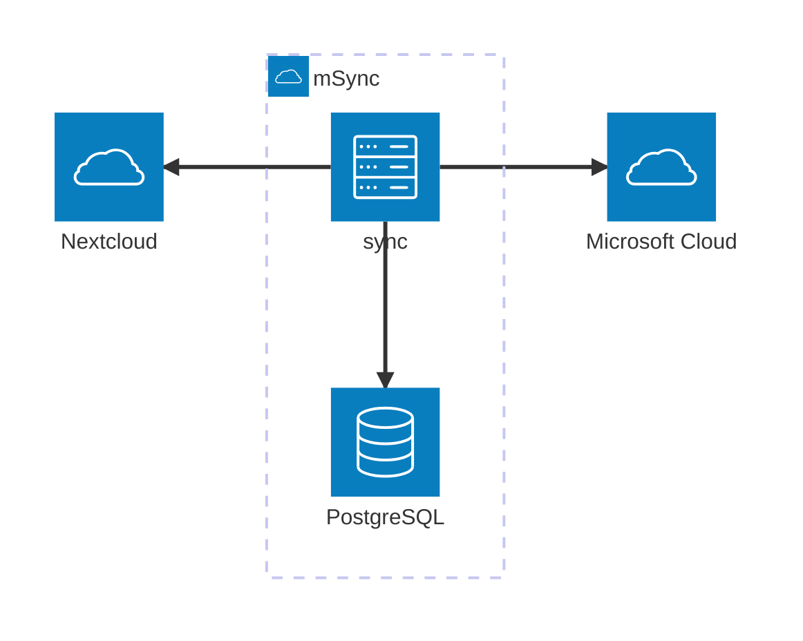
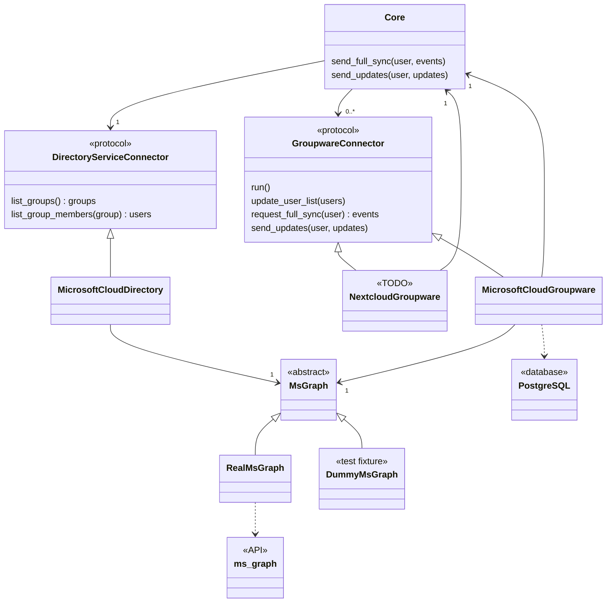

# Architecture

The general philosophy is to push state as far out from the core logic as possible.
Ideally, our solution would be completely stateless, but for practical reasons,
it has to hold some state.

The solution is a monolithic service (`sync`), running as a Docker container in
Docker Copose, along an off-the-shelf PostgreSQL service. The two are deployed to Hetzner cloud.

PostgreSQL does not store any long-term state, it is used as a work-queue for
synchronization, and to cache data.

The actual long-term state is the responsibility of the groupware systems (Nextcloud
and Microsoft). All calendar data is stored there.

mSync's job is thus merely to reconcile the state between external systems, rather
than owning any of the data.

## Project structure

The scheduling logic lives at the edges of the service, in the connectors that
talk with the external systems. These connectors essentially "watch" for changes
in the external state, and issue updates accordingly to the "core" of the application.

The `Core` is like a telephone exchange for updates, it responds to updates coming
from one connector, figures out what other connector should receive it, and then
forwards it. It does not hold on to any state after having forwarded an update.

`GroupwareConnector` is an abstract interface for the components that talk with
the external calendars. It's the handle that `Core` uses to forward updates to.

`DirectoryServiceConnector` is an abstract interface for the components that hold
information about user groups and user memberships to groups. Currently, this is
just Microsoft Entra ID, but the idea is that it could be replaced by Microsoft AD
or by LDAP in the future.

These abstractions exist so that we can easily transition to a microservice
architecture in the future, if the need arises, and we can also add support for
other external systems by just implementing a new connector, without touching
the `Core` logic.

> [!note]
>
> In the following diagram, class and method names are not 100% accurate to what
> is currently in the master branch.

## User registration

Users do not manually sign up to the service, it is entirely a backend service
that is managed by an admin through group memberships.

Some specific groups are used to configure which users need to be synced from
one groupware system to another. Currently:
- `msync-microsoft_cloud-nextcloud`: members of this group use Microsoft Cloud
  as their primary or "source" calendar, and Nextcloud as a copy or "mirror" calendar.
- `msync-nextcloud-microsoft_cloud`: members of this group use Nextcloud as
  their source and Microsoft as their mirror.

On a loop, we fetch the list of users that are in these groups, and send them
to the respective connectors. This does not need to happen very frequently.

Core receives the list of users, and distributes them to the "source" connectors,
so if a user is in `msync-microsoft_cloud-nextcloud`, it needs to be sent to the
`MicrosoftCloudGroupware` connector.

Connectors have a database table that they use as a work queue, each row is a
user. Whenever a new list of active users is received, we go through each row
and either enable or disable the user. Or we create a new row if the user has
never been seen.

When a user is removed from a group, the respective row in the database will
eventually be set to "disabled", and the user will simply not be synced anymore.
We don't do anything to the data that has already been synced once a user leaves.

## Microsoft sync scheduling

There are a number of workers that constantly try to acquire a synchronization
job from the work queue. The way this works is as follows:
- A worker will sort the table by the least recently updated user
- It will look for the first active user that is not locked by another worker
- It will acquire the lock
- Atomicity is handled by PostgreSQL, for free

Once a worker has a job, it figures out whether it needs to do a _full-sync_
or a _delta-sync_.
- A _full-sync_ is needed if there is no cached _delta-link_, or if the _delta-link_
  is expired, or if the last full sync was done long ago (some threshold. like 24 hours).
- Otherwise, a delta sync is performed.

A _full-sync_ works like this:
- We read every event from the users calendar, this also gives us a _delta-link_,
  which we cache for later.
- We send the list of events to `Core`
- `Core` requests the full list of events for the same user on the other side of
  the sync
- `Core` calculates a diff between the two lists
- `Core` sends the diff to the mirror system, which fixes the calendar so it is
  up to date.

A _delta-sync_ works like this:
- We read from a user calendar, providing a _delta-link_. Instead of returning every
  event, Microsoft returns only the changes since the _delta-link_ was minted, and
  a new _delta-link_, which we cache.
- We send the updates to `Core`.
- `Core` forwards the updates to the mirror system.

## Nextcloud sync scheduling

This has not been defined yet, but is probably similar to Microsoft.
