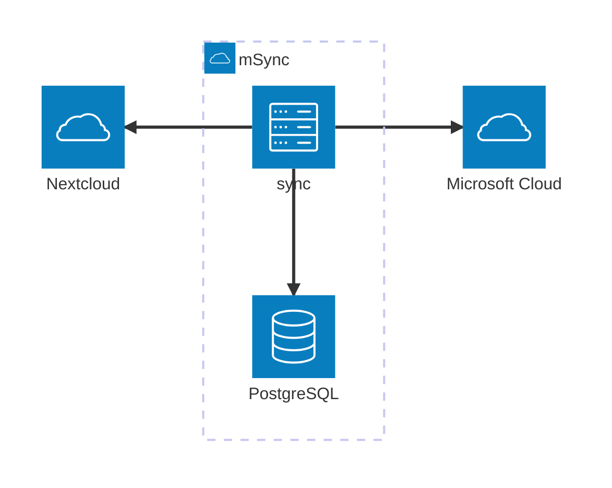
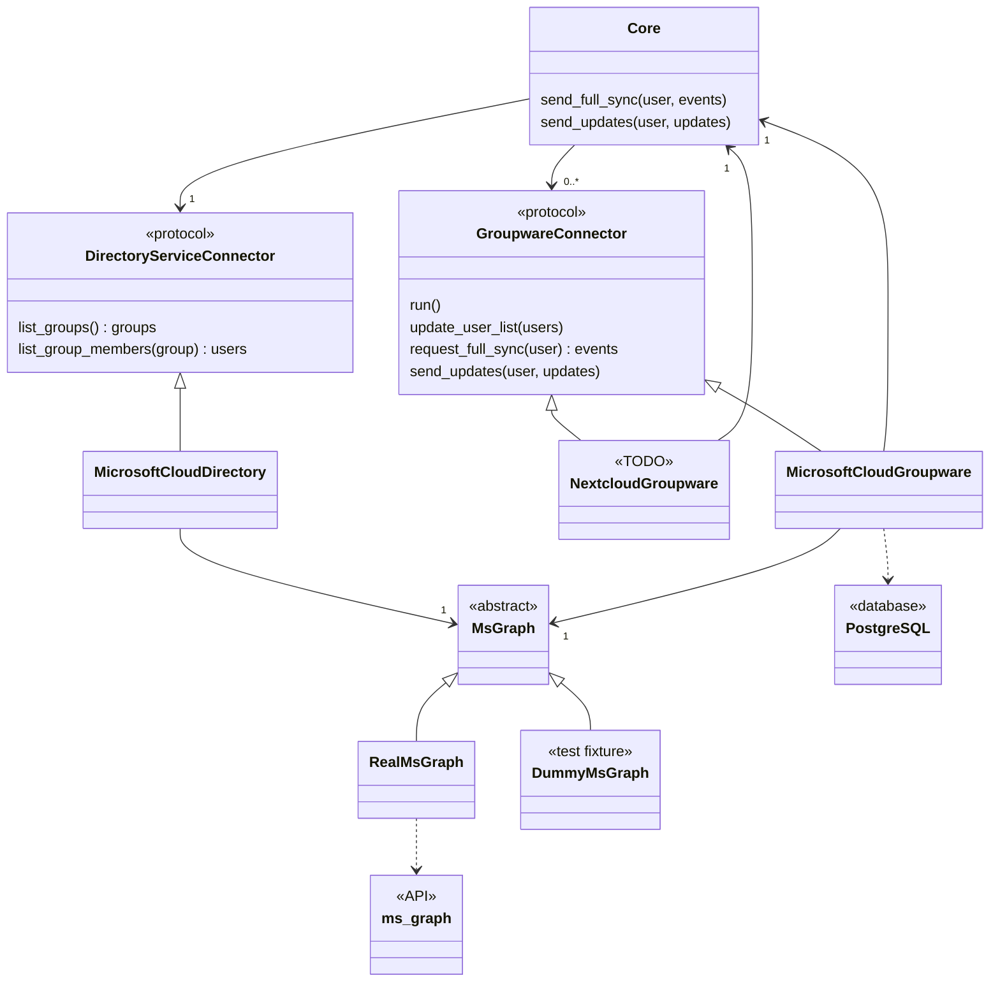

# Architecture

The general philosophy is to push state as far out from the core logic as possible.
Ideally, our solution would be completely stateless, but for practical reasons,
it has to hold some state.

The solution is a monolithic service (`sync`), running as a Docker container in
Docker Copose, along an off-the-shelf PostgreSQL service. The two are deployed to Hetzner cloud.

PostgreSQL does not store any long-term state, it is used as a work-queue for
synchronization, and to cache data.

The actual long-term state is the responsibility of the groupware systems (Nextcloud
and Microsoft). All calendar data is stored there.

mSync's job is thus merely to reconcile the state between external systems, rather
than owning any of the data.

## Project structure

The scheduling logic lives at the edges of the service, in the connectors that
talk with the external systems. These connectors essentially "watch" for changes
in the external state, and issue updates accordingly to the "core" of the application.

The `Core` is like a telephone exchange for updates, it responds to updates coming
from one connector, figures out what other connector should receive it, and then
forwards it. It does not hold on to any state after having forwarded an update.

`GroupwareConnector` is an abstract interface for the components that talk with
the external calendars. It's the handle that `Core` uses to forward updates to.

`DirectoryServiceConnector` is an abstract interface for the components that hold
information about user groups and user memberships to groups. Currently, this is
just Microsoft Entra ID, but the idea is that it could be replaced by Microsoft AD
or by LDAP in the future.

These abstractions exist so that we can easily transition to a microservice
architecture in the future, if the need arises, and we can also add support for
other external systems by just implementing a new connector, without touching
the `Core` logic.

> [!note]
>
> In the following diagram, class and method names are not 100% accurate to what
> is currently in the master branch.

