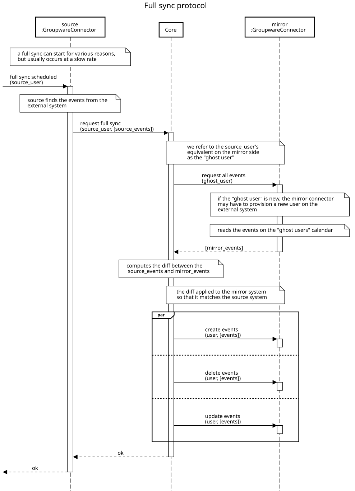
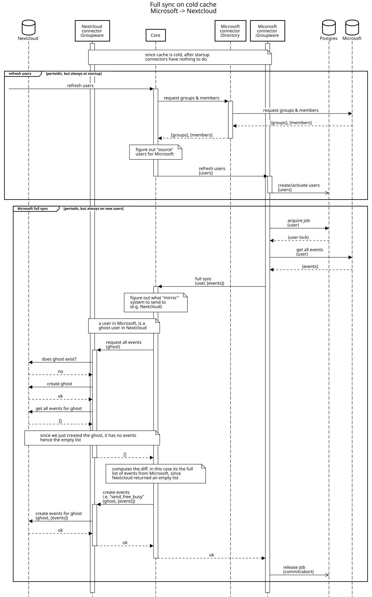

# Protocols

Here is the definition of the protocols used between `Core` and the connectors.

> [!note]
>
> TODO: we haven't strictly defined this yet.

## Full-sync

This refers to when a connector initiates a sync over the entire history of
a users calendar, rather than just sending individual updates. When this happens,
the connector tells `Core` what the user's list of events is, and `Core` then has
to diff the mirror system's current state to see if they agree.

This needs to happen occasionally because:
- Events may be lost, so we need an occasional full-sweep to ensure eventual consistency
- At startup, we don't have any events to compare to, so we can't make a "delta sync"
- We might be forced to do a full sync by the API of the groupware system, as the
  token they give us to keep track of changes can expire or become invalid

The following diagram illustrates a prototypical full-sync.

## Detailed examples

These are example traces of what happens in some specific scenarios.

### Full sync on a cold cache

This diagram illustrates a full sync that is initiated by the Microsoft connector,
where the cache is cold, so ghost users don't exist yet on Nextcloud.

